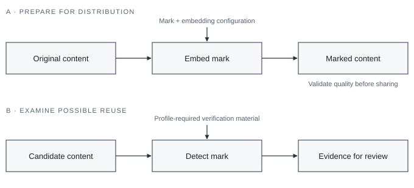

# Traceweave: Embedded Content Marks and Cryptographic Provenance

Traceweave is an open specification for recognising your own work when it turns up somewhere else, and for producing evidence of the match that anyone can re-run and check. It is designed to cover any kind of work: source code, writing, images and audio. One shared evidence format sits underneath, with a profile for each medium. Your content never leaves your machine; only fingerprints are compared.

**Status: experimental draft, 0.1.0-draft.1.** Go and Rust source code are the first two case studies. Their token profiles, extraction and matching vectors, and catalogue and report contracts are published here. Two independent implementations, in a separate repository, reproduce every published vector. TypeScript, text and still-image profiles are at earlier stages, as the [roadmap](ROADMAP.md) records. Nothing here is yet a production detector, signing client, resolver or agent skill. No detection rate has been measured, and resilience to transformations is a goal to measure for each profile, not a guarantee. The [synthetic carrier and signing interoperability experiments](research/experiment-checkpoint.md) remain research records.

Traceweave separates three questions: which exact artifact a record describes, whether another artifact contains similar material, and what evidence supports that relationship. Cryptographic verification authenticates a record; it does not make a similarity claim true or establish ownership, infringement, or model training.

The specification and algorithms are public. Owners can keep their keys, reference catalogues, and investigation records private. The default design works locally and does not require publishing an identity, fingerprint vector, or signing event.

## Start with the use cases

A central planned workflow embeds a mark into content before distribution, then checks later content for that mark. A complementary workflow extracts fingerprints from existing content to find candidate matching fragments without modifying it. Both feed reviewable evidence; signatures and timestamps provide separate provenance checks. These workflows are not implemented yet.



*Figure 1. Proposed embedded-mark workflow. Detection may return insufficient evidence. Extracted fingerprint matching and provenance verification are separate supporting processes; detecting a mark does not establish ownership.*

Read the [use cases](docs/use-cases.md), [delivery roadmap](ROADMAP.md), [implementation patterns and example matrix](docs/implementation-patterns.md), and [source register](docs/sources.md).

## Read the draft

| Document | Purpose |
| --- | --- |
| [Core](spec/core.md) | Record semantics, exact subjects and private commitments |
| [Attestations](spec/attestations.md) | DSSE/in-toto integration and verification boundaries |
| [Threat model](spec/threat-model.md) | Adversaries, privacy, false claims, and failure cases |
| [Conformance](spec/conformance.md) | What the checks establish and what remains unimplemented |
| [Extraction contract](spec/extraction.md) | Token-fingerprint extraction, including the Go and Rust token profiles (experimental draft, normative for this draft version) |
| [Catalogue and report contract](spec/catalogue-report.md) | Catalogues, comparison and reports (experimental draft, normative for this draft version) |
| [Code profile](profiles/code.md) | First fingerprinting experiment and reproducibility requirements |
| [TypeScript/JavaScript profile](profiles/typescript.md) and [text profile](profiles/text.md) | Stage-1 profiles `ts-tokens` and `text-plain` (frozen), with `tsx-tokens` and `text-markdown` as drafts |
| [Other content profiles](profiles/README.md) | Text, image, audio, and binary research scope |
| [Schemas](schemas/README.md) | Machine-readable draft formats |
| [Test vectors](test-vectors/README.md) | Commitment and DSSE vectors, and the extraction, matching, TypeScript and text vectors with their checkers |
| [Examples](examples/README.md) | Synthetic, unsigned records with known artifact bytes |
| [Evaluation](docs/evaluation.md) | Attack matrix and false-positive calibration |
| [Roadmap](ROADMAP.md) | Implementation gates and open decisions |
| [Draft review](docs/reviews/initial-draft-review.md) | Corrections to the supplied design |

## Check this repository

Python 3.11 or newer is required. From the repository root:

```sh
python3 -m venv .venv
.venv/bin/python -m pip install -r requirements-dev.txt
.venv/bin/python tools/validate.py
.venv/bin/python -m unittest discover -s tests -v
```

The validator checks schema structure, synthetic examples, exact fixture digests, commitment openings, DSSE framing vectors, the extraction, matching, TypeScript and text vector checkers (each must exit 0), and local Markdown links. It does **not** authenticate a signer, validate a timestamp authority, measure clone detection, or establish a false-positive rate. It performs no network requests.

## Contribute and reuse

See [CONTRIBUTING.md](CONTRIBUTING.md) and [SECURITY.md](SECURITY.md). Discussion should distinguish proposed mechanisms, measured results, and normative requirements. Alternative implementations are welcome; the planned CLI and skill will be optional conveniences.

Specification prose is licensed under CC BY 4.0. Schemas, examples, test vectors, source code, and configuration are licensed under Apache 2.0. See [LICENSE.md](LICENSE.md). These licenses do not change the rights in content processed by an implementation.
