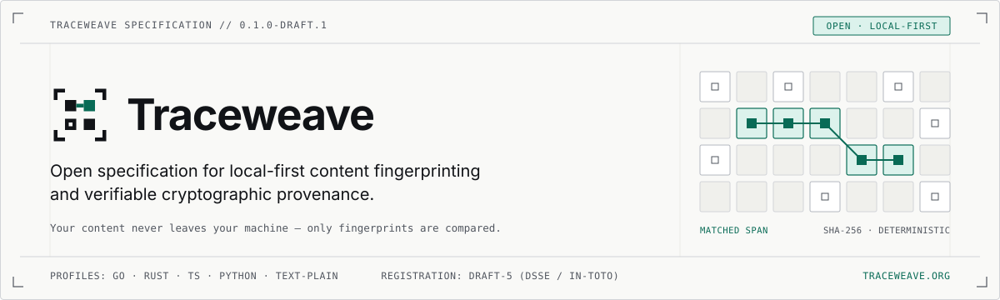
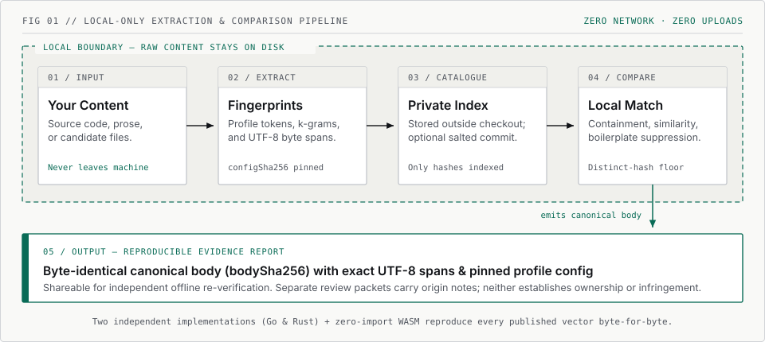
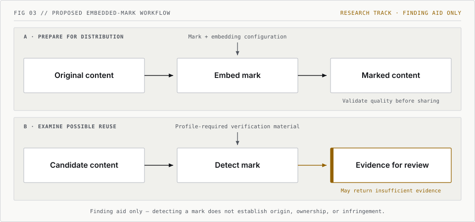

<picture>
  <source media="(prefers-color-scheme: dark)" srcset="docs/assets/traceweave-banner-dark.svg">
  <source media="(prefers-color-scheme: light)" srcset="docs/assets/traceweave-banner-light.svg">
  
</picture>

# Traceweave

Traceweave is an open, non-commercial specification for recognising your own work when it turns up somewhere else, and for producing evidence of the match that anyone can re-run and check. One shared evidence format sits underneath, with versioned extraction profiles for each medium (source code, writing, and planned image/audio profiles). Your content never leaves your machine; only fingerprints are compared.

[Website (traceweave.org)](https://traceweave.org) · [Documentation (docs.traceweave.org)](https://docs.traceweave.org) · [Roadmap](ROADMAP.md) · [Use cases](docs/use-cases.md) · [License](LICENSE.md)

## Contents

- [Status and scope](#status-and-scope)
- [How it works](#how-it-works)
- [Three questions and two tracks](#three-questions-and-two-tracks)
- [Profiles and maturity](#profiles-and-maturity)
- [Specification index](#specification-index)
- [Verify this repository locally](#verify-this-repository-locally)
- [License and contributing](#license-and-contributing)

## Status and scope

**Experimental draft `0.1.0-draft.1`**, open and non-commercial. Progress is tracked against verifiable gates in [ROADMAP.md](ROADMAP.md):

- **Core M0–M5:** **28 of 47** gates met — including all M0–M2 extraction, catalogue, and report contracts, the M3.0 false-alarm budget, and all 6/6 M4 offline-first registration gates (`traceweave-registration-draft-5`, promoted vectors + independent Rust/Go parity, commitment/disclosure review, verifier-local trust policy, and in-toto adapter fixtures).
- **Profiles & extensions:** **21 of 55** gates met, plus **2 recorded negative results** (`TXT.4` repeated-structure prose ambiguity in Stage 1; `TXT.8` Unicode text marks erased by standard folding).
- **Frozen Stage-1 profiles:** `go-tokens`, `rs-tokens`, `ts-tokens`, `py-tokens`, and `text-plain` all have published hand-derived test vectors. Two independent reference implementations (Go and Rust, in a separate repository) plus a zero-import WebAssembly build reproduce every published vector byte-for-byte.

**Epistemic boundaries (read first):**

- Nothing here is yet a production detector, signing client, resolver, or agent skill.
- No detection rate has been measured; resilience to transformations is a goal to measure per profile, not a guarantee.
- Cryptographic verification authenticates a record; it does **not** make a similarity claim true or establish ownership, copyright infringement, or model training.
- Synthetic carrier and signing interoperability runs ([experiment-checkpoint.md](research/experiment-checkpoint.md)) remain research records. C2PA 2.5 mapping is a draft proposal with fixtures; no C2PA compatibility is claimed.

## How it works

The specification and algorithms are public, while owners keep their keys, reference catalogues, and investigation records private. The default workflow runs strictly offline on your own machine and does not require publishing an identity, fingerprint vector, or signing event.

<picture>
  <source media="(prefers-color-scheme: dark)" srcset="docs/assets/traceweave-pipeline-dark.svg">
  <source media="(prefers-color-scheme: light)" srcset="docs/assets/traceweave-pipeline-light.svg">
  
</picture>

1. **Extract locally:** A versioned profile tokenizes source bytes into deterministic k-gram fingerprints and original UTF-8 byte spans, pinned by `configSha256`.
2. **Index privately:** Fingerprints are stored in a local catalogue outside your working tree, with optional salted commitments so you can commit to a catalogue without revealing its contents.
3. **Compare deterministically:** Candidate files are matched against the catalogue with fragment containment and whole-file similarity reported as separate fields, explicit boilerplate suppression, and a distinct-hash minimum floor.
4. **Emit verifiable evidence:** Comparison outputs a canonical report body (`bodySha256`) that any second verifier can reproduce byte-for-byte offline. Origin and dependency notes live in a separate review-packet record, never inside the comparison report.

## Three questions and two tracks

Traceweave separates three distinct questions: **which exact artifact** a record describes, **whether another artifact contains similar material**, and **what evidence supports that relationship**. Conflating similarity with provenance causes false claims, so the specification keeps them on two separate tracks:

<picture>
  <source media="(prefers-color-scheme: dark)" srcset="docs/assets/traceweave-two-tracks-dark.svg">
  <source media="(prefers-color-scheme: light)" srcset="docs/assets/traceweave-two-tracks-light.svg">
  
</picture>

### Proposed embedded-mark workflow (research track)

Alongside extracted fingerprint matching and signed registration records, a research track explores embedding a mark into content before distribution and checking later content for that mark. No marking method is standardized yet, and synthetic image-mark results show marks can serve at most as a **finding aid**—never as proof of origin.

<picture>
  <source media="(prefers-color-scheme: dark)" srcset="docs/assets/traceweave-embedded-mark-dark.svg">
  <source media="(prefers-color-scheme: light)" srcset="docs/assets/traceweave-embedded-mark-light.svg">
  
</picture>

*Figure 3. Proposed embedded-mark workflow. Detection may return insufficient evidence. Extracted fingerprint matching and provenance verification are separate supporting processes; detecting a mark does not establish ownership.*

For full scenarios and architecture trade-offs, read the [use cases](docs/use-cases.md), [delivery roadmap](ROADMAP.md), [implementation patterns and example matrix](docs/implementation-patterns.md), and [source register](docs/sources.md).

## Profiles and maturity

| Medium / Profile | Identifier | Stage | Notes |
| :--- | :--- | :--- | :--- |
| Go source code | `go-tokens` | Frozen Stage-1 | Published vectors; Go, Rust & WASM parity (`M1`–`M2` met) |
| Rust source code | `rs-tokens` | Frozen Stage-1 | Published vectors; Go, Rust & WASM parity (`M1`–`M2` met) |
| TypeScript / JS | `ts-tokens` | Frozen Stage-1 | Published vectors; Go & Rust parity (`TS.3` met); `tsx-tokens` deferred draft |
| Python | `py-tokens` | Frozen Stage-1 | Promoted `draft-1`; Go & Rust parity (`PY.1`–`PY.3` met); `PY.4` awaits M3 |
| Plain text | `text-plain` | Frozen Stage-1 | Published vectors; Go & Rust parity (`TXT.3` met); `text-markdown` draft; `TXT.4` & `TXT.8` negative results recorded |
| Still images | `IMGF` / `IMG` | Research only | Synthetic PDQ/ISCC contract check (`IMGF.2`–`IMGF.4`); image marks are finding-aid only (`IMG.0`–`IMG.4`) |
| C2PA 2.5 mapping | `org.traceweave.*` | Draft proposal | Mapping & fixtures checked (`C2PA.1` draft); no compatibility claimed (`C2PA.3`) |
| Audio, video & binary | — | Scoping / research | [Audio/video scoping](research/lanes/15-audio-video-scoping.md); [other content profiles](profiles/README.md) |

## Specification index

### Core & registration

| Document | Purpose |
| :--- | :--- |
| [Core](spec/core.md) | Record semantics, exact subjects, private commitments, and salted possession |
| [Attestations](spec/attestations.md) | DSSE/in-toto integration, commitment/disclosure verification, and trust/time boundaries |
| [Registration record](spec/registration-record.md) | Offline-first DSSE registration statements, key events, time evidence, `tw1-` references, and verification (`traceweave-registration-draft-5`) |
| [Trust policy](spec/trust-policy.md) | Verifier-local policy, key-event trust propagation, independence groups, and revocation freshness |
| [Timestamp adapter decision](docs/decisions/timestamp-adapter-decision.md) | Architectural decision record on optional RFC 3161 and OpenTimestamps verification |
| [Threat model](spec/threat-model.md) | Adversaries, privacy, false claims, and failure cases |
| [Conformance](spec/conformance.md) | What the checks establish and what remains unimplemented |

### Extraction & profiles

| Document | Purpose |
| :--- | :--- |
| [Extraction contract](spec/extraction.md) | Token-fingerprint extraction, including the Go and Rust token profiles (experimental draft, normative for this draft version) |
| [Catalogue and report contract](spec/catalogue-report.md) | Catalogues, comparison, boilerplate suppression, and reports (experimental draft, normative for this draft version) |
| [Code profile](profiles/code.md) | First fingerprinting experiment and reproducibility requirements |
| [TypeScript / JavaScript profile](profiles/typescript.md) | Stage-1 `ts-tokens` (frozen) and `tsx-tokens` (deferred draft) |
| [Python profile](profiles/python.md) | Stage-1 `py-tokens` (`draft-1`, frozen) |
| [Text profile](profiles/text.md) | Stage-1 `text-plain` (frozen) and `text-markdown` (draft) |
| [Other content profiles](profiles/README.md) | Image, audio, video, and binary research scope |

### Schemas, vectors & examples

| Document | Purpose |
| :--- | :--- |
| [Schemas](schemas/README.md) | Machine-readable JSON Schema (Draft 2020-12) formats |
| [Test vectors](test-vectors/README.md) | Commitment, DSSE, in-toto adapter, registration, extraction, matching, TypeScript, Python, and text vectors with independent checkers |
| [Examples](examples/README.md) | Synthetic, unsigned records with known artifact bytes |

### Evaluation, use cases & governance

| Document | Purpose |
| :--- | :--- |
| [Use cases](docs/use-cases.md) | Concrete workflows (`UC-1`–`UC-7`, proposed `UC-8`) and walkthroughs |
| [Implementation patterns](docs/implementation-patterns.md) | Architecture patterns and example assertion matrix |
| [Evaluation](docs/evaluation.md) | Attack matrix and false-positive calibration |
| [Source register](docs/sources.md) | Primary technical sources and references |
| [Roadmap](ROADMAP.md) | Gate definitions, progress counts, and owner decisions |
| [Draft review](docs/reviews/initial-draft-review.md) | Corrections to the initial design |

## Verify this repository locally

Python 3.11 or newer is required. All checks run strictly offline with zero network requests:

```sh
python3 -m venv .venv
.venv/bin/python -m pip install -r requirements-dev.txt
.venv/bin/python tools/validate.py
.venv/bin/python tools/validate.py --links-all
.venv/bin/python -m unittest discover -s tests -v
```

The validator checks JSON Schema structure, synthetic examples, exact fixture digests, commitment openings, DSSE framing vectors, promoted schemas, all promoted vector checkers (extraction, matching, TypeScript, Python, text, registration, in-toto adapter, image-mark finding aid, C2PA fixtures, and the requirement map), and local Markdown links. It does **not** authenticate a signer, validate a timestamp authority, measure clone detection, or establish a false-positive rate.

## License and contributing

Traceweave is open and non-commercial. Contributions and independent implementations are welcome—see [CONTRIBUTING.md](CONTRIBUTING.md) and [SECURITY.md](SECURITY.md). Discussion should distinguish proposed mechanisms, measured results, and normative requirements.

- **Specification prose and Markdown documentation:** [Creative Commons Attribution 4.0 International (CC BY 4.0)](LICENSES/CC-BY-4.0.txt)
- **Schemas, examples, test vectors, source code, and configuration:** [Apache License, Version 2.0 (Apache-2.0)](LICENSES/Apache-2.0.txt)
- **Unicode-derived vector data tables:** [Unicode License v3](LICENSES/Unicode-3.0.txt)

See [LICENSE.md](LICENSE.md) for the full licensing notice. These licenses cover this repository only and do not change the rights in content processed by an implementation.
